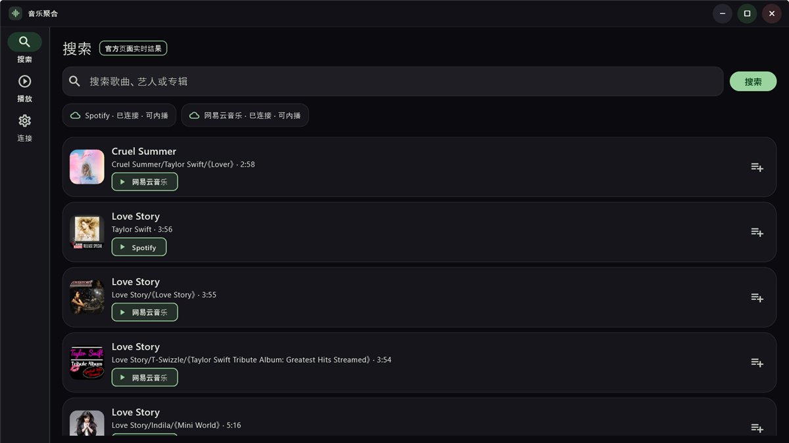
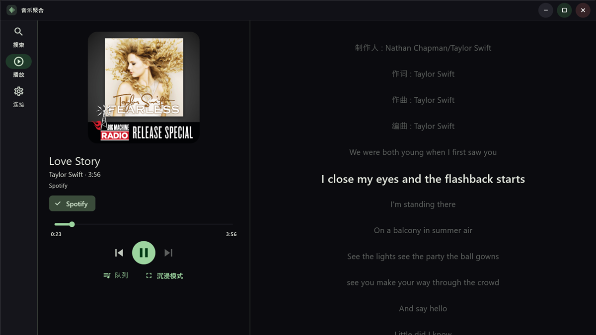
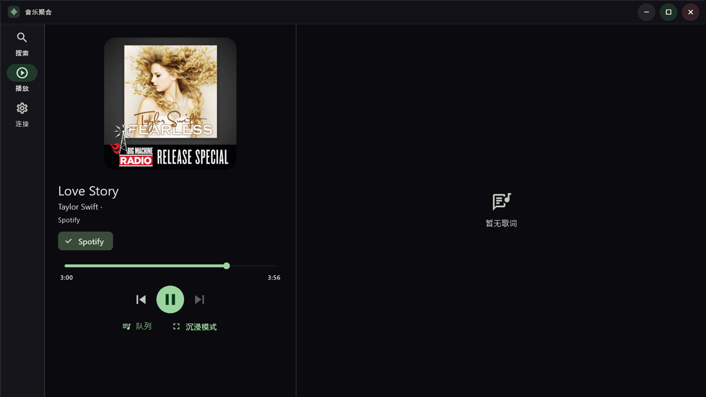

# 音乐聚合 · MusicMerge

把 **Spotify** 和 **网易云音乐** 放进一个播放器：一次搜索同时出两家的结果，
播放时自动配同步歌词，界面完全由自己控制（官方网页只负责在后台出声）。

Flutter 编写，Windows 桌面为主，Android 共用同一套业务代码。



<p align="center">
  
  
</p>

## 特性

- **双平台联合搜索**：一个搜索框并行查询 Spotify 与网易云的官方网页，结果标准化后合并；
  高置信度同曲合并成一条（标题/艺人标准化 + 版本标记完全一致 + 时长差 ≤ 8s），来源可切换。
- **Spotify 客户端内播放**：不依赖 Premium 与 Web Playback SDK——应用内嵌 Spotify 官方网页播放器，
  直接控制其底层播放元素，实现播放/暂停、拖动进度、音量、切歌。
- **网易云客户端内播放**：同样驱动官方网页，读取官方播放列表并在应用队列里点击切歌。
- **跨服务歌词**：Spotify 曲目起播后，按标题/艺人/时长去网易云匹配同曲，取带时间戳的 LRC。
- **Apple Music 风格沉浸歌词**：焦点行弹簧上浮、逐字发光、间奏呼吸点、模糊专辑背景。
- **保守去重**：Live / Remix / 现场等版本标记必须完全一致才合并，宁可多一条也不错合并。
- **无边框 Windows 窗口**：应用内标题栏与最小化/最大化/关闭。
- **能力不撒谎**：连接页逐项展示搜索 / 元数据 / 歌词 / 内播 / 跳转能力与登录状态。

## 工作原理（一句话）

应用启动时把两个官方网页（`music.163.com`、`open.spotify.com`）各挂在一个 WebView2 里，
盖在自己的界面下方；通过 `AT_DOCUMENT_START` 注入脚本登记并操作官方页面的
`<audio>/<video>` 元素，音频由官方页面自己输出。

- 不请求、不解析、不落盘任何音频流；不涉及 DRM 解密。
- 账号在官方页面里由用户自己登录，登录态只存在本机 WebView2 profile
  （`%LOCALAPPDATA%\MusicMerge\webview2`），应用不接触密码。
- 搜索与歌词解析都发生在官方页面上下文里，不调用任何私有 API。

细节与实测记录见 [docs/web-player-feasibility.md](docs/web-player-feasibility.md)。

## 环境要求

| 项目 | 版本 |
| --- | --- |
| 系统 | Windows 10 1809+ / 11（需要 WebView2 Runtime，Win11 自带） |
| Flutter | 3.47+（Dart 3.13+） |
| Visual Studio | 2022/2026，勾选「使用 C++ 的桌面开发」 |
| Android（可选） | JDK 21、Android SDK 36、AGP 8.13.1 |

## 构建与运行

```powershell
flutter pub get
flutter analyze            # 要求 0 issue
flutter test               # 175 个测试
flutter run -d windows     # 本地调试运行
flutter build windows --debug
```

Windows 构建注意：

1. Flutter 带插件的桌面构建需要系统开启「开发人员模式」（符号链接）。
2. `flutter_inappwebview_windows` 需要 `nuget.exe` 拉取 WebView2 SDK，把它放进 `PATH` 即可。
3. 首次构建较慢（要编译 WebView2 相关插件），之后是增量。

## 使用

1. 启动应用 → 「连接」→ 官方网页播放器里点某一家的「打开官方页面」，在官方页面登录一次。
   两家各登录一次，之后一直有效。
2. 回「搜索」输入关键词 → 结果里同时出现两家的来源按钮。
3. 点结果或来源按钮开始播放 → 「播放」页控制进度/暂停；Spotify 曲目会自动配上同步歌词。

### 可选配置

Spotify Web API 搜索（PKCE）默认不需要；想启用时在「连接」页填入自己在
[Spotify Developer Dashboard](https://developer.spotify.com/dashboard) 创建的应用 Client ID，
回调地址填 `http://127.0.0.1:8080/callback`。

```powershell
flutter run -d windows --dart-define=SPOTIFY_CLIENT_ID=你的客户端ID
```

> 客户端 ID 是公开标识；**不要**把 client secret 放进客户端。

调试用的构建参数（一般用不到）：`DSH_AUTO_OPEN_OFFICIAL`、`DSH_AUTO_SEARCH`、
`DSH_AUTO_PLAY_FIRST`、`DSH_WEB_SERVICE`，以及环境变量 `DSH_WEBVIEW_DEBUG_PORT`
（打开 WebView2 远程调试端口，配合 `tool/spotify_cdp_verify.ps1`）。

## 目录结构

```
lib/
├── application/   唯一状态源 MusicController、播放时钟
├── domain/        模型、去重、歌词时间轴、播放状态机（纯 Dart）
├── platform/      官方网页播放器引擎、注入脚本、PKCE、凭证存储
├── providers/     Provider 契约 + Spotify 真实实现 + 演示实现
└── presentation/  搜索页、播放页、沉浸歌词、连接页与组件
test/              领域 / 应用 / Provider / Widget 测试（175 个）
tool/              脚本自检、WebView2 CDP 验证、预览入口
docs/              设计文档、网页播放器可行性记录、接入边界
```

## 测试

```powershell
flutter test
node tool/verify_web_player_scripts.mjs   # 用真实注入脚本跑 Spotify 的 DOM 形状
```

`tool/spotify_cdp_verify.ps1` 可以在应用以 `DSH_WEBVIEW_DEBUG_PORT` 启动后，
通过 CDP 读取/驱动官方页面，用于排查播放链路。

## 文档

- [网页播放器可行性与实测记录](docs/web-player-feasibility.md)
- [接入边界与隐私](docs/provider-integration.md)
- [跨平台设计](docs/superpowers/specs/2026-10-31-cross-platform-music-client-design.md)

## 许可

[MIT](LICENSE)。

## 声明

本项目是个人学习作品，与 Spotify、网易云音乐无任何关联，未获其授权或认可。
Spotify / 网易云音乐的名称与商标归各自所有者。

- 播放发生在你本机的官方网页里，音频由官方页面输出；本项目不下载、不转码、不分发音频内容。
- 需要你自己的账号；登录信息保存在本机，不会上传。
- 各服务的可用性、界面与规则随时可能变化，脚本选择器随之失效属于正常现象，欢迎提 issue。
